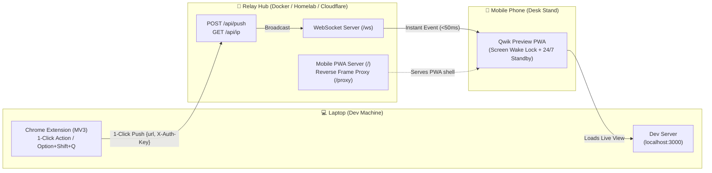

# ⚡ Qwik Mobile Preview

<div align="center">

[](https://opensource.org/licenses/MIT)
[](https://hub.docker.com/r/iamjothees/qwik-mobile-preview)
[](https://github.com/iamjothees/qwik-mobile-preview)
[](https://github.com/iamjothees/qwik-mobile-preview)
[](https://github.com/iamjothees/qwik-mobile-preview/pulls)

**Preview any `localhost` app on your real mobile phone in LAN in 1 click.**  
*Stop typing `192.168.x.x:3000` on your touchscreen keyboard 50 times a day.*

[Demo](#-video-demo) • [The Problem](#-the-core-problem) • [Quick Start](#-quick-start) • [Security & Auth Key](#-securing-your-relay-hub-auth_key) • [Architecture](#-architecture) • [Cloudflare / Homelab](#-homelab--cloudflare-tunnel-setup)

</div>

---

## 📹 Video Demo

<!-- Upload your video or GIF to GitHub issues/releases or docs/ and paste the URL below -->
https://github.com/user-attachments/assets/demo-preview.mp4

> 💡 **The Workflow:** Keep your phone docked on your desk stand. Hit <kbd>Cmd</kbd>+<kbd>Shift</kbd>+<kbd>Q</kbd> on your laptop. Your phone screen updates in **`< 50ms`**. The screen stays awake permanently. Zero touches required.

---

## 😫 The Core Problem

When testing mobile responsive layouts, touch gestures, and camera inputs during local frontend development:

1. **Typing IP and port numbers on a phone keyboard is painful**: You run `ifconfig` to find your local IP, open your phone browser, and carefully type `http://192.168.29.10:3000/some/deep/route?id=42` on a touchscreen.
2. **Every port change restarts the hassle**: Vite on `5173`, Next.js on `3000`, Rails on `3001` — each time you switch branches or projects, you have to type the IP and port all over again.
3. **QR codes still require too much physical effort**: You have to pick up your phone, unlock it, switch to the camera app, point it at the monitor, and tap the link banner — 50+ times every work day.
4. **Mobile screens constantly go to sleep**: After 60 seconds of coding, iOS and Android lock the screen, forcing you to unlock the phone again.

---

## ⚡ The Solution: Qwik Mobile Preview

| Scenario | Old Way | Qwik Preview |
| :--- | :--- | :--- |
| **Pushing localhost to phone** | Look up IP, type `192.168.x.x:3000` on touch keyboard | **1-Click** (or `Option+Shift+Q` / `Alt+Shift+Q`) |
| **Latency** | 10–30 seconds of typing & checking | **< 50 milliseconds** via local WebSockets |
| **Screen Lock** | Screen dims and locks every 60 seconds | **Always Awake** via Screen Wake Lock API |
| **Phone Handling** | Pick up phone, point camera, tap popup | **Hands-free**: phone stays on your desk dock |
| **Security** | Open to anyone on network | **Optional Secret `AUTH_KEY` protection** |

---

## 🌟 Features

- **⚡ True 1-Click Instant Push**: Sub-50ms dispatch from laptop to mobile over persistent local WebSockets.
- **🔄 Automatic Localhost ➔ LAN IP Conversion**: Automatically swaps `http://localhost:3000` with your machine's physical network IP (`http://192.168.x.x:3000`).
- **📱 24/7 Desk Standby Mode (PWA)**:
  - **Screen Wake Lock API**: Keeps your phone screen awake on your desk dock — no dimming or auto-locking.
  - **Silent Audio Keep-Alive**: Prevents iOS Safari & Android Chrome from throttling background WebSockets.
  - **Catch-up Sync**: Automatically grabs the newest pushed link the instant you reopen the app.
- **🛡️ HTTPS Mixed-Content Bypass**: Smart reverse frame-proxy injects `<base href>` so HTTP local dev servers render inside HTTPS/Cloudflare PWAs with zero browser security errors.
- **🔒 Secret `AUTH_KEY` Protection**: Secure public homelab/Cloudflare tunnel endpoints against unauthorized pushes.
- **🐳 Multi-Arch Docker Hub Image**: Lightweight Alpine container (`~50MB`) supporting `linux/amd64` and `linux/arm64` (Apple Silicon, Raspberry Pi, Mini PCs).
- **🔍 Offline QR Code Fallback**: Instant offline QR generator built right into the extension popup for one-off previews on unpaired devices.

---

## 🏗️ Architecture



---

## 🚀 Quick Start

### Step 1: Run the Relay Hub (1 Command)

Run on your laptop or any machine on your local network:

```bash
docker run -d \
  --name qwik-mobile-preview \
  --restart unless-stopped \
  -p 4567:4567 \
  iamjothees/qwik-mobile-preview:latest
```

*(Or clone this repo and run `./start.sh` or `docker compose up -d`)*

Verify it is running:
- Open `http://localhost:4567` on your laptop.
- It displays your active LAN URL (e.g. `http://192.168.29.10:4567`).

---

### Step 2: Open Mobile Receiver (Once)

On your mobile phone (connected to the same Wi-Fi / LAN):
1. Navigate to:
   ```
   http://<YOUR_LAN_IP>:4567
   ```
   *(e.g., `http://192.168.29.10:4567` or your secured Cloudflare domain)*
2. Tap **"⚡ Activate 24/7 Desk Mode"** to keep the screen permanently active.
3. **Install as App (PWA)**:
   - **Android**: Tap **"📲 Install App"** (or 3 dots → *Install App*).
   - **iOS Safari**: Tap **Share** (⎋) → **"Add to Home Screen"**.
4. Place your phone on your desk stand.

---

### Step 3: Install the Chrome Extension

1. Download or clone this repository.
2. In Chrome, go to `chrome://extensions/`.
3. Enable **"Developer mode"** (top right toggle).
4. Click **"Load unpacked"** (top left) and select the [`extension/`](extension/) directory.
5. Pin the **Qwik Mobile Preview** icon to your toolbar.

---

### Step 4: Preview in 1 Click!

- Browse any localhost app on your laptop (`http://localhost:3000`, `http://localhost:5173`, etc.).
- **Click the extension icon** (or press <kbd>Cmd</kbd>+<kbd>Shift</kbd>+<kbd>Q</kbd> on Mac / <kbd>Ctrl</kbd>+<kbd>Shift</kbd>+<kbd>Q</kbd> on Windows/Linux).
- The extension icon flashes a green **`✓`** badge.
- **Your phone screen updates immediately in real time (< 50ms)!**

---

## 🔒 Public Multi-Tenancy & Device Pairing Keys

`qwik-mobile-preview` includes **built-in room isolation and rate limiting**, making it safe to host publicly (e.g. `https://qwik-preview.joecodes.in`) for multiple developers simultaneously:

### 1. Zero-Config Device Pairing Keys
- Each Chrome extension automatically generates a private pairing key (e.g., `qwik-7x8k2m`).
- Open `https://qwik-preview.joecodes.in/?pair=qwik-7x8k2m` on your phone (or scan the **Pair Phone 📲** QR code directly in the extension popup).
- Your laptop will **only push tabs to phones sharing your exact pairing key**. Multiple users can use the same server without cross-talk or interference.
- Pairing sessions are ephemeral and auto-expire after 24 hours of inactivity.

### 2. Built-in Web Security & Rate Limiting
- **Sliding-Window Rate Limiting**: Max 20 pushes per minute per IP, max 100 API requests per minute. Returns `429 Too Many Requests` with `Retry-After`.
- **Connection Caps**: Max 10 mobile receivers per pairing key; max 500 concurrent WebSockets across the hub.
- **Payload & Protocol Sanitization**: Strictly allows `http://` and `https://` URLs (blocks `javascript:`, `data:`, `file:` URIs). Max payload size of 10 KB (blocks memory exhaustion).

---

## 🌐 Production Deployment (Homelab / Cloudflare Tunnel / VPS)

For production deployment (e.g. at `qwik-preview.joecodes.in`), use the provided **`docker-compose.prod.yml`** and **`.env.production`**:

1. Copy `.env.production` to `.env` on your server:
   ```bash
   cp .env.production .env
   ```
2. Start the production stack (includes Watchtower for zero-downtime auto-updates):
   ```bash
   docker compose -f docker-compose.prod.yml up -d
   ```
3. Point your Cloudflare Tunnel hostname or Traefik reverse proxy to `http://qwik-mobile-preview-prod:4567`.
4. In the Chrome extension options, set **Relay Server URL** to your HTTPS domain (e.g., `https://qwik-preview.joecodes.in/`).
5. Open your public domain on your phone — enjoy full native PWA installation with valid TLS and instant WebSockets!

---

## ⌨️ Keyboard Shortcuts & Customization

| Shortcut | Description |
| :--- | :--- |
| <kbd>Option</kbd>+<kbd>Shift</kbd>+<kbd>Q</kbd> *(Mac)* | Push active tab to mobile instantly |
| <kbd>Alt</kbd>+<kbd>Shift</kbd>+<kbd>Q</kbd> *(Win/Linux)* | Push active tab to mobile instantly |

**Right-Click Extension Toolbar Icon:**
- `⚡ Push this tab to mobile`: Explicit manual push of current tab.
- `📱 Mobile Preview Dashboard`: Open popup dashboard, pairing QR code, or settings.
- `📱 Open Mobile Receiver in Browser`: Quick link to open the receiver.

---

## 🤝 Contributing

Contributions, feedback, and bug reports are welcome!

1. Fork the Project.
2. Create your Feature Branch (`git checkout -b feature/AmazingFeature`).
3. Commit your Changes (`git commit -m 'feat: add some amazing feature'`).
4. Push to the Branch (`git push origin feature/AmazingFeature`).
5. Open a Pull Request.

---

## 📜 License

Distributed under the **MIT License**. See [`LICENSE`](LICENSE) for more information.

---

<div align="center">
Made with ❤️ by <a href="https://joecodes.in">Joe Codes</a>
</div>
