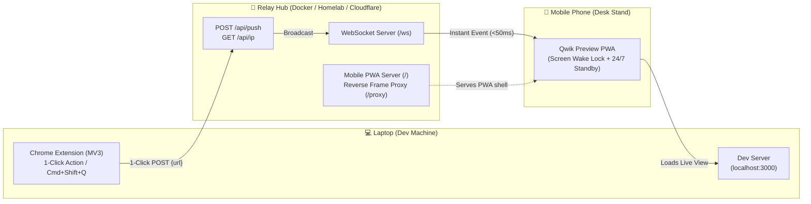

# ⚡ Qwik Mobile Preview

<div align="center">

[](https://opensource.org/licenses/MIT)
[](https://hub.docker.com/r/iamjothees/qwik-mobile-preview)
[](https://github.com/iamjothees/qwik-mobile-preview)
[](https://github.com/iamjothees/qwik-mobile-preview)
[](https://github.com/iamjothees/qwik-mobile-preview/pulls)

**Preview any `localhost` app on your real mobile device in LAN in 1 click.**  
*Zero IP typing. Zero QR code scanning. Real-time sub-50ms push. 24/7 Stay-Awake desk mode.*

[Features](#-why-qwik-preview) • [Quick Start](#-quick-start) • [Architecture](#-architecture) • [Cloudflare / Homelab](#-homelab--cloudflare-tunnel-setup) • [Contributing](#-contributing)

</div>

---

## 😫 The Problem It Solves

Testing responsive layouts on real physical mobile hardware during local development is notoriously painful:

| The Old Way | The Friction |
| :--- | :--- |
| **Manual IP Typing** | Look up `ifconfig`/`ipconfig`, replace `localhost`, and type `192.168.29.10:3000/nested/path?query=1` on a touchscreen keyboard every time. |
| **QR Code Generators** | Pick up phone, open camera, point at laptop screen, tap notification banner — repeated 50 times an hour. |
| **Cloud Tunnels (ngrok/localtunnel)** | Account signups, bandwidth throttles, high latency, and exposes your incomplete code to the public web. |
| **Screen Timeout** | Your phone goes to sleep every 60 seconds while you write code, forcing you to unlock it again. |

### ⚡ The Qwik Preview Way
1. Leave your mobile phone docked on a desk stand next to your laptop.
2. Hit **`Cmd+Shift+Q`** (or click the extension icon in Chrome).
3. **Your phone screen instantly updates in `< 50ms`**. The screen stays awake permanently on your desk stand. Zero touches required.

---

## 🌟 Highlights

- **⚡ True 1-Click Instant Push**: Sub-50ms dispatch from laptop to mobile over persistent local WebSockets.
- **🔄 Zero-Config Localhost Translation**: Automatically swaps `http://localhost:3000` with your laptop's physical LAN IP (`http://192.168.x.x:3000`).
- **📱 24/7 Desk Standby Mode (PWA)**:
  - **Screen Wake Lock API**: Keeps your phone screen awake on your desk dock — no dimming or auto-locking.
  - **Silent Audio Keep-Alive**: Prevents mobile OSes (iOS Safari & Android) from throttling background WebSockets.
  - **Catch-up Sync**: Automatically grabs the newest pushed link the second you open the app if it was backgrounded.
- **🛡️ HTTPS Mixed-Content Bypass**: Smart reverse frame-proxy injects `<base href>` so HTTP local dev servers render inside HTTPS/Cloudflare PWAs with zero browser security errors.
- **🐳 Multi-Arch Docker Hub Image**: Ready-to-go lightweight Node 22 Alpine container (`~50MB`) supporting `linux/amd64` and `linux/arm64` (Raspberry Pi / Apple Silicon / Mini PCs).
- **🔍 Offline QR Code Fallback**: Instant offline QR generator built right into the extension popup for one-off previews on unpaired devices.

---

## 🏗️ Architecture



---

## 🚀 Quick Start

### Step 1: Run the Relay Hub (1 Command)

You can run the relay hub directly on your laptop or on any homelab machine in your local network:

```bash
docker run -d \
  --name qwik-mobile-preview \
  --restart unless-stopped \
  -p 4567:4567 \
  iamjothees/qwik-mobile-preview:latest
```

*(Or clone this repo and run `./start.sh` or `docker compose up -d`)*

Verify it is running:
- Open `http://localhost:4567` on your laptop.
- It displays your active LAN URL (e.g. `http://192.168.29.10:4567`).

---

### Step 2: Open Mobile Receiver (Once)

On your mobile phone (connected to the same Wi-Fi / LAN):
1. Navigate to:
   ```
   http://<YOUR_LAN_IP>:4567
   ```
   *(e.g., `http://192.168.29.10:4567` or your secured Cloudflare domain)*
2. Tap **"⚡ Activate 24/7 Desk Mode"** to keep the screen permanently active.
3. **Install as App (PWA)**:
   - **Android**: Tap the **"📲 Install App"** button (or 3 dots → *Install App*).
   - **iOS Safari**: Tap the **Share** button (⎋) → **"Add to Home Screen"**.
4. Place your phone on your desk stand.

---

### Step 3: Install the Chrome Extension

1. Download or clone this repository.
2. In Chrome, go to `chrome://extensions/`.
3. Enable **"Developer mode"** (top right toggle).
4. Click **"Load unpacked"** (top left) and select the [`extension/`](extension/) directory.
5. Pin the **Qwik Mobile Preview** icon to your toolbar.

---

### Step 4: Preview in 1 Click!

- Browse any localhost app on your laptop (`http://localhost:3000`, `http://localhost:5173`, etc.).
- **Click the extension icon** (or press <kbd>Cmd</kbd>+<kbd>Shift</kbd>+<kbd>Q</kbd> on Mac / <kbd>Ctrl</kbd>+<kbd>Shift</kbd>+<kbd>Q</kbd> on Windows/Linux).
- The extension icon flashes a green **`✓`** badge.
- **Your phone screen updates immediately in real time (< 50ms)!**

---

## 🌐 Homelab / Cloudflare Tunnel Setup

If you run a homelab server with Cloudflare Tunnel or reverse proxy (e.g. Traefik, Caddy, Nginx Proxy Manager):

1. Connect the service to your proxy network in `docker-compose.yml`:
   ```yaml
   services:
     qwik-preview:
       image: iamjothees/qwik-mobile-preview:latest
       container_name: qwik-mobile-preview
       restart: unless-stopped
       ports:
         - "4567:4567"
       networks:
         - proxy_net
   networks:
     proxy_net:
       external: true
   ```
2. Point your Cloudflare Tunnel hostname (e.g. `https://preview.yourdomain.com`) to `http://qwik-mobile-preview:4567`.
3. In the Chrome extension options, set **Relay Server URL** to `https://preview.yourdomain.com`.
4. Open `https://preview.yourdomain.com` on your phone — enjoy full native PWA installation with valid TLS!

---

## ⌨️ Keyboard Shortcuts & Customization

| Shortcut | Description |
| :--- | :--- |
| <kbd>Cmd</kbd>+<kbd>Shift</kbd>+<kbd>Q</kbd> *(Mac)* | Push active tab to mobile instantly |
| <kbd>Ctrl</kbd>+<kbd>Shift</kbd>+<kbd>Q</kbd> *(Win/Linux)* | Push active tab to mobile instantly |

**Right-Click Extension Toolbar Icon:**
- `⚡ Push this tab to mobile`: Explicit manual push.
- `🔍 QR Code & Settings`: View offline QR code, change LAN interfaces, or adjust click behavior.
- `📱 Open Mobile Receiver in Browser`: Quick link to open the receiver.

---

## 🔒 Privacy & Security

- **100% Local / Self-Hosted**: All URLs and WebSocket events are transmitted directly within your local network or to your private homelab server.
- **Zero Analytics or Telemetry**: No third-party trackers, no cookies, no cloud telemetry.
- **Explicit Triggers**: Tab URLs are only read when you explicitly click the action button or press the keyboard shortcut.

---

## 🤝 Contributing

Contributions, feedback, and bug reports are welcome!

1. Fork the Project.
2. Create your Feature Branch (`git checkout -b feature/AmazingFeature`).
3. Commit your Changes (`git commit -m 'feat: add some amazing feature'`).
4. Push to the Branch (`git push origin feature/AmazingFeature`).
5. Open a Pull Request.

---

## 📜 License

Distributed under the **MIT License**. See [`LICENSE`](LICENSE) for more information.

---

<div align="center">
Made with ❤️ by <a href="https://joecodes.in">Joe Codes</a>
</div>
